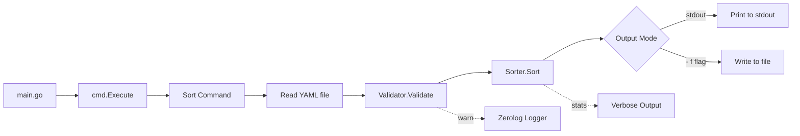

# Requirements

### Overview & Goals

Create a Go-written CLI binary called **sortinator** that reads a YAML file containing a list of IP addresses, sorts
them numerically, and outputs the result. The tool handles both IPv4 and IPv6 addresses, skips invalid entries with
warnings, and supports multiple output modes.

### Scope

**In Scope:**

- Read YAML file with IP list under `ips:` key
- Sort IPs numerically (IPv4 and IPv6)
- Skip invalid entries with warnings
- Output to stdout (default) or file (`-f/--file`)
- Flags: `-r/--reverse`, `-u/--unique`, `-v/--verbose`, `--version`
- Human-readable logging via zerolog

**Out of Scope:**

- In-place editing without flags
- Support for other YAML keys besides `ips:`
- Network connectivity or DNS resolution
- Configuration files or environment variables

### User Stories

- As a DevOps engineer, I want to sort my IP list so that it's organized numerically for easier review.
- As a sysadmin, I want invalid entries to be skipped with warnings so I can identify issues quickly.
- As a developer, I want to pipe output or write to a file so I can integrate it into my workflow.

### Functional Requirements

1. **Input**: Accept a YAML file path as a positional argument.
2. **Sorting**: IPs sorted numerically by their binary representation (IPv4 and IPv6).
3. **Validation**: Non-IP entries are skipped and logged as warnings.
4. **Output**: Printed to stdout by default; written to file with `-f` flag.
5. **Flags**:
    - `-f, --file string` — write output to specified file
    - `-r, --reverse` — sort in descending order
    - `-u, --unique` — remove duplicate IPs
    - `-v, --verbose` — show statistics summary
    - `--version` — print version and exit

### Non-Functional Requirements

- Binary should be compilable with `go build`
- Clean, human-readable log messages via zerolog
- Exit code 0 on success, non-zero on fatal errors (file not found, parse errors)

# Technical Design

### Current Implementation

The project is a fresh Go repository at `/home/mishagin/github/sortinator` with only a `test.yaml` sample file
containing:

```yaml
ips:
  - 10.0.0.1
  - invalid-string
  - 8.8.8.8
  - 192.168.0.1
  - 54.12.2.192
```

### Key Decisions

1. **Cobra for CLI** — Industry-standard Go CLI framework with automatic help, flag parsing, and version support.
2. **yaml.v3 for parsing** — gopkg.in/yaml.v3 for flexible YAML handling.
3. **Zerolog for logging** — Fast, human-readable JSON/text logging with warning level for invalid entries.
4. **Internal package structure** — Business logic separated into `internal/sorter` and `internal/validator`.

### Proposed Changes

#### Project Structure

```
sortinator/
├── main.go                 # Entry point, calls cmd.Execute()
├── go.mod                  # Go module definition
├── go.sum
├── cmd/
│   ├── root.go             # Root command with flags definition
│   └── sort.go             # Sort subcommand implementation
└── internal/
    ├── sorter/
    │   └── sorter.go       # IP sorting logic (IPv4 + IPv6)
    └── validator/
        └── validator.go    # IP validation and filtering
```

#### Data Models / Contracts

**YAML Input Structure:**

```go
type IPConfig struct {
IPs []string `yaml:"ips"`
}
```

**Sorted Output Structure:**

```go
type SortedResult struct {
IPs      []string `yaml:"ips"`
Skipped  int // for verbose stats
Dropped  int // for verbose stats (duplicates)
}
```

**Command Flags (cmd/root.go):**

```go
var (
outputFile string // -f, --file
reverse    bool   // -r, --reverse
unique     bool   // -u, --unique
verbose    bool   // -v, --verbose
version    string // set at build time
)
```

### Architecture Diagram



### Risks

- **IPv6 sorting complexity**: IPv6 addresses need special handling (expand to full form, convert to bytes, compare).
  Use Go's `net.ParseIP` and `To16()` for normalization.
- **YAML structure flexibility**: Users may have different YAML structures. The tool assumes `ips:` as the top-level
  key — document this clearly.
- **Duplicate handling**: IPv4-mapped IPv6 addresses (e.g., `::ffff:192.168.0.1`) should be treated as distinct from
  their IPv4 counterparts unless explicitly normalized.

# Testing

### Validation Approach

Validate the tool by building the binary and testing with the provided `test.yaml` and additional edge cases.

### Key Scenarios

1. **Basic sort**: Run `./sortinator test.yaml` — verify IPs are sorted numerically (8.8.8.8, 10.0.0.1, 54.12.2.192,
   192.168.0.1) with "invalid-string" skipped and warned.
2. **File output**: Run `./sortinator test.yaml -f output.yaml` — verify output.yaml contains sorted IPs.
3. **Reverse sort**: Run `./sortinator test.yaml -r` — verify descending order.
4. **Unique flag**: Test with duplicate IPs — verify only one copy appears.
5. **Verbose mode**: Run `./sortinator test.yaml -v` — verify stats summary (sorted count, skipped count).
6. **IPv6 support**: Test with mixed IPv4/IPv6 list — verify correct sorting.
7. **Version flag**: Run `./sortinator --version` — verify version string is printed.

### Edge Cases

- Empty YAML file (`ips: []`)
- All entries are invalid
- File does not exist (should error with non-zero exit)
- Mixed valid/invalid entries
- IPv4-mapped IPv6 addresses

# Delivery Steps

### Step 1: Initialize project structure and dependencies

Set up the Go module, install dependencies (cobra, yaml.v3, zerolog), and create the project directory structure.

- Initialize Go module with `go mod init github.com/mishagin/sortinator`
- Create `cmd/` directory with `root.go` (root command, flags, version)
- Create `internal/sorter/` package for IP sorting logic
- Create `internal/validator/` package for IP validation
- Create `main.go` entry point that calls `cmd.Execute()`
- Add dependencies: `go get github.com/spf13/cobra`, `gopkg.in/yaml.v3`, `github.com/rs/zerolog/log`

### Step 2: Implement IP validation and sorting core logic

Implement the `internal/validator` and `internal/sorter` packages that handle IP validation, filtering, and numerical
sorting for both IPv4 and IPv6.

- Create `internal/validator/validator.go` with `ValidateIPs([]string) ([]string, int)` — returns valid IPs and count of
  skipped entries
- Create `internal/sorter/sorter.go` with `SortIPs([]string, bool) ([]string, int)` — sorts IPs numerically, handles
  reverse flag, deduplication
- Implement IPv4 sorting by converting to uint32
- Implement IPv6 sorting by converting to 16-byte array
- Handle mixed IPv4/IPv6 sorting (IPv4 first, then IPv6, or unified by binary value)
- Add zerolog warning output for each skipped invalid entry

### Step 3: Implement CLI commands and YAML processing

Implement the Cobra CLI commands that tie together YAML parsing, validation, sorting, and output.

- Create `cmd/root.go` with root command, flag definitions (-f, -r, -u, -v, --version)
- Create `cmd/sort.go` with the sort subcommand that:
    - Reads YAML file using yaml.v3 into `IPConfig` struct
    - Calls validator to filter invalid entries
    - Calls sorter to sort and optionally deduplicate
    - Writes output to stdout or file based on flags
    - Prints verbose stats if -v flag is set
- Wire up `main.go` to execute the root command

### Step 4: Build, test, and verify the binary

Build the binary and validate all functionality against test cases.

- Build with `go build -o sortinator .`
- Test with `test.yaml` — verify correct numerical sort order
- Test `-f/--file` flag — verify file output
- Test `-r/--reverse` flag — verify descending order
- Test `-u/--unique` flag — verify deduplication
- Test `-v/--verbose` flag — verify stats output
- Test `--version` flag — verify version display
- Test error handling: missing file, empty file, all-invalid entries